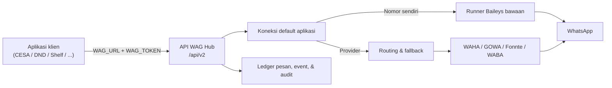

<p align="center">
  
</p>

<h1 align="center">WhatsApp Gateway Hub (WAG Hub)</h1>

<p align="center">
  Satu service WhatsApp untuk semua aplikasi: nomor sendiri (QR/pairing) atau provider
  (WAHA, GOWA, Fonnte, WABA), dengan routing, fallback, inbox, dan ledger pesan.
</p>

Aplikasi klien (CESA, DND, Shelf, Apps Script, dan lainnya) **cukup memakai dua
variabel** dan **satu endpoint**. Socket WhatsApp, kredensial provider, routing, dan
riwayat pengiriman semuanya dikelola di WAG Hub.

```dotenv
WAG_URL=https://gateway.example.com
WAG_TOKEN=token-khusus-aplikasi
```



## Daftar isi

- [Fitur](#fitur)
- [Mulai cepat untuk aplikasi klien](#mulai-cepat-untuk-aplikasi-klien)
- [Menjalankan WAG Hub secara lokal](#menjalankan-wag-hub-secara-lokal)
- [Engine bawaan (runner Baileys)](#engine-bawaan-runner-baileys)
- [Panel admin](#panel-admin)
- [Referensi API](#referensi-api)
- [Konfigurasi environment](#konfigurasi-environment)
- [Deploy production](#deploy-production)
- [Perintah artisan](#perintah-artisan)
- [Pengujian](#pengujian)
- [Dokumentasi lanjutan](#dokumentasi-lanjutan)

## Fitur

- **Plug and play**: aplikasi klien hanya butuh `WAG_URL` + `WAG_TOKEN`; koneksi default dipakai otomatis.
- **Dua jenis koneksi WhatsApp**:
  - *Nomor sendiri* (`managed_number`): login QR/pairing lewat runner Baileys bawaan, kirim teks, gambar, dokumen, dan voice.
  - *Provider* (`provider_route`): WAHA, GOWA, Fonnte, WABA, atau engine WAG Hub, dengan routing dan fallback berurutan.
- **Aman untuk retry**: header `Idempotency-Key` wajib; request yang diulang tidak pernah terkirim dua kali.
- **Status jujur**: timeout/respons ambigu menjadi `unknown` (`outcome_unknown`), tanpa fallback buta.
- **Cek nomor WhatsApp** dengan rute dan audit tersendiri.
- **Inbox & otomasi**: Inbox WhatsApp, Balasan Otomatis, Menu Bot, Flow Builder, dan Knowledge Base (AI opsional).
- **Monitoring**: ledger pesan, attempt per provider, latency, circuit breaker provider, alert, dan log viewer.
- **Keamanan**: token per aplikasi disimpan sebagai hash; nomor, isi pesan, metadata, dan konfigurasi provider dienkripsi; URL provider internal/metadata ditolak.

## Mulai cepat untuk aplikasi klien

1. Di panel WAG Hub buka **Aplikasi Klien** → buat/pilih aplikasi.
2. Buka **Hubungkan WhatsApp** → pilih **Pakai nomor WhatsApp saya** (scan QR / pairing) atau **Pakai provider**.
3. Kirim pesan uji, lalu salin `WAG_URL` dan `WAG_TOKEN` dari langkah terakhir ke `.env` aplikasi klien.
4. Kirim pesan:

```bash
curl -X POST "$WAG_URL/api/v2/messages" \
  -H "Authorization: Bearer $WAG_TOKEN" \
  -H 'Idempotency-Key: order-1001' \
  -H 'Content-Type: application/json' \
  -d '{"to": "081234567890", "text": "Pesanan Anda sudah dikirim."}'
```

Respons sukses selalu `202`:

```json
{"data": {"status": "queued", "id": "…", "connection_id": "…", "transport_status": "queued"}}
```

Aturan singkat:

- `to` boleh format apa saja (`0812-3456-7890`, `+62 812 …`). Nomor `0…` otomatis diberi kode negara `GATEWAY_DEFAULT_COUNTRY_CODE` (default `62`).
- `Idempotency-Key` wajib. Saat hasil `unknown` atau koneksi putus, ulangi dengan **key yang sama**. Key sama dengan body berbeda → `409 idempotency_conflict`.
- `connection` (opsional) berisi ID koneksi bila aplikasi punya beberapa nomor. Tanpa itu dipakai koneksi default (koneksi pertama otomatis menjadi default).
- `expires_at` (opsional) membatalkan pesan yang belum terkirim setelah waktu tersebut.

**Kirim file** lewat URL publik (maks. 16 MB); `text` menjadi caption:

```bash
curl -X POST "$WAG_URL/api/v2/messages" \
  -H "Authorization: Bearer $WAG_TOKEN" \
  -H 'Idempotency-Key: invoice-1001' \
  -H 'Content-Type: application/json' \
  -d '{"to": "081234567890", "document": "https://cdn.example.com/INV-1001.pdf", "text": "Invoice Anda"}'
```

Kunci file: `image`, `document`, atau `voice` (khusus nomor sendiri). Bentuk panjang
`{"type": "image", "media_url": "…"}` atau `media_id` dari `POST /api/v2/media` juga diterima.

**Cek status pesan:**

```bash
curl "$WAG_URL/api/v2/messages/ID_PESAN" -H "Authorization: Bearer $WAG_TOKEN"
```

| Status | Makna |
|---|---|
| `queued` | Menunggu/sedang dikirim. |
| `sent` | Diterima WhatsApp atau provider. |
| `delivered` | Sampai di perangkat penerima. |
| `read` | Dibaca (voice: diputar). |
| `failed` | Gagal. |
| `expired` | Batas waktu lewat sebelum terkirim. |
| `unknown` | Hasil tidak pasti; ulangi dengan `Idempotency-Key` yang sama. |

Contoh klien siap pakai: [PHP](docs/examples/php/WagClient.php) ·
[JavaScript](docs/examples/javascript/wag.js) · [Python](docs/examples/python/wag.py).
Panduan lengkap: [docs/PLUG_AND_PLAY_GUIDE.md](docs/PLUG_AND_PLAY_GUIDE.md).

## Menjalankan WAG Hub secara lokal

### Prasyarat

- PHP **8.4.1+** (ekstensi `sqlite3`/`pdo_mysql`, `mbstring`, `xml`, `curl`, `zip`, `bcmath`, `intl`), Composer.
- Node.js (untuk build aset Vite). Runner Baileys butuh **Node 22.14+**.
- Opsional: Redis + ekstensi `phpredis` (bila memakai `QUEUE_CONNECTION=redis` / Horizon).

### Instalasi

```bash
cp .env.example .env
composer install
npm ci
touch database/database.sqlite
php artisan key:generate
php artisan migrate --seed
php artisan storage:link
npm run build
```

`.env.example` memakai `QUEUE_CONNECTION=redis`. Jika tidak ada Redis, ganti menjadi
`QUEUE_CONNECTION=database`.

`db:seed` membuat:

- Admin `admin@gateway.local` / `admin12345` (ubah lewat `GATEWAY_SEED_ADMIN_NAME`,
  `GATEWAY_SEED_ADMIN_EMAIL`, `GATEWAY_SEED_ADMIN_PASSWORD` sebelum seed). Alternatif tanpa
  menyimpan password di `.env`: `php artisan gateway:create-admin`.
- Aplikasi klien `appscript-ft`, `web-cesa`, `web-helpdesk`, `web-sam`, `web-shelf`.
- Akun provider WAHA, Fonnte, GOWA, WABA beserta route default (urutan WAHA → Fonnte → GOWA → WABA).
  Provider hanya aktif bila kredensial `GATEWAY_SEED_*` lengkap; selain itu dibuat nonaktif dan
  dapat dilengkapi dari panel.
- Token aplikasi hanya bila `GATEWAY_SEED_*_TOKEN` diisi. Lebih aman menerbitkan token dari panel.

Seeder aman dijalankan ulang.

### Menjalankan

Cara tercepat (server, queue, log, dan Vite sekaligus):

```bash
composer dev
```

Atau jalankan proses terpisah:

```bash
php artisan serve                                 # web + API, http://localhost:8000
php artisan queue:work --tries=1 --timeout=360    # atau: php artisan horizon (Redis)
php artisan schedule:work                         # wajib: pemulihan, tick engine, cleanup
```

Opsional:

```bash
php artisan reverb:start                          # realtime panel (isi REVERB_APP_KEY dkk.)
cd engine/baileys-runner && npm ci && npm start   # engine bawaan untuk "nomor sendiri"
```

Buka `http://localhost:8000/panel` lalu login dengan akun admin.

> Lokal, `GATEWAY_DISPATCH=sync` (default `.env.example`) mengirim pesan langsung di request
> tanpa worker. Di production biarkan kosong/`async` dan jalankan queue worker.

## Engine bawaan (runner Baileys)

Koneksi **nomor sendiri** dijalankan oleh runner Node/Baileys privat di
[`engine/baileys-runner`](engine/baileys-runner/README.md). Aplikasi klien tidak pernah
mengakses runner ini secara langsung.

1. Salin `engine/baileys-runner/.env.example` ke `.env`, isi `WAG_BAILEYS_TOKEN`,
   kredensial MySQL, `WAG_BAILEYS_AUTH_KEY` (`openssl rand -base64 32`), dan
   `WAG_HUB_CONTROL_URL` (origin Hub).
2. Di `.env` Hub isi token yang sama:

   ```dotenv
   GATEWAY_ENGINE_DRIVER=wag_hub
   WAG_BAILEYS_URL=http://127.0.0.1:3318
   WAG_BAILEYS_TOKEN=token-internal-yang-sama
   ```

3. Jalankan `npm ci --omit=dev && npm start` di bawah process manager. Ikat runner ke
   loopback/jaringan privat saja.

Kapasitas sesi per aplikasi diatur dengan `php artisan engine:grant-capacity <slug> <ceiling> --limit=<n>`
(default `WAG_DEFAULT_SESSION_LIMIT=5`, `WAG_DEFAULT_SESSION_CEILING=10`).
Stack Docker (Hub + runner + MySQL): [`engine/docker-compose.v2.yml`](engine/docker-compose.v2.yml),
panduan operasi: [docs/ENGINE_V2.md](docs/ENGINE_V2.md). Engine WAHA self-hosted dan mock untuk
development: [engine/README.md](engine/README.md).

> Baileys/WhatsApp Web bersifat tidak resmi. Untuk OTP/volume tinggi gunakan WABA resmi.

## Panel admin

Panel Filament ada di `/panel`. Menu utama:

| Grup | Menu |
|---|---|
| Aplikasi | **Aplikasi Klien** (token, kapasitas, logo, URL) |
| WhatsApp | **Hubungkan WhatsApp**, Koneksi WhatsApp, Pesan, Inbox WhatsApp, Pengecekan Nomor |
| Perangkat | Perangkat WhatsApp |
| Provider | Akun Provider, Aturan Rute (pengiriman & cek nomor, urutan fallback) |
| Automasi | Balasan Otomatis, Menu Bot, Flow Builder, Knowledge Base (AI) |
| Alert | Pengaturan Alert, Preferensi Alert, Riwayat Alert |
| Server | Dokumentasi Integrasi |

Akun provider, aturan rute, dan fallback adalah pengaturan lanjutan; aplikasi klien tidak
perlu mengetahuinya. Log viewer tersedia di `/log-viewer` dan Horizon di `/horizon` (khusus admin).

## Referensi API

Semua endpoint memakai `Authorization: Bearer <WAG_TOKEN>`. Token dari panel sudah memiliki
ability yang dibutuhkan. Kontrak lengkap: [docs/openapi-v2.yaml](docs/openapi-v2.yaml).

### API v2 (untuk integrasi baru)

| Aksi | Endpoint |
|---|---|
| Kirim pesan (koneksi default) | `POST /api/v2/messages` |
| Status pesan | `GET /api/v2/messages/{id}` |
| Daftar / buat koneksi | `GET` / `POST /api/v2/connections` |
| Detail koneksi (QR / kode pairing) | `GET /api/v2/connections/{id}` |
| Hubungkan ulang / ulangi setup | `POST /api/v2/connections/{id}/connect` · `/retry` |
| Kirim lewat koneksi tertentu | `POST /api/v2/connections/{id}/messages` |
| Sesi engine (kelola nomor) | `GET/POST /api/v2/sessions`, `GET/PATCH/DELETE /api/v2/sessions/{id}`, `POST /api/v2/sessions/{id}/{start\|stop\|logout}` |
| Login sesi | `GET /api/v2/sessions/{id}/auth/qr` · `POST /api/v2/sessions/{id}/auth/pairing-code` |
| Media | `POST /api/v2/media` · `GET /api/v2/media/{id}` |
| Event (replay) | `GET /api/v2/events?after={cursor}` |
| Integrasi & webhook | `GET/PATCH /api/v2/integration` · `PUT /api/v2/integration/webhook` |
| Health | `GET /health/live` · `GET /health/ready` · `GET /up` |

Error memakai format `{"message": "...", "error": {"code": "...", "retryable": true|false}}`.

### Cek nomor WhatsApp

```bash
curl -X POST "$WAG_URL/api/v1/number-checks" \
  -H "Authorization: Bearer $WAG_TOKEN" \
  -H 'Content-Type: application/json' \
  -d '{"recipient": {"type": "phone", "value": "081234567890"}}'
```

Memakai **Aturan Rute** berjenis *Cek nomor WhatsApp*; provider dicek berurutan sampai hasil
definitif. Hasil: `registered`, `not_registered`, `unknown` (gagal/tidak pasti, bukan berarti
invalid), atau `unsupported`. Respons berisi `data.id` (ID audit) dan `checks` per provider.
Riwayat ada di **WhatsApp → Pengecekan Nomor**. Rate limit-nya terpisah dari pengiriman pesan.
Lookup didukung oleh WAG Hub bawaan, WAHA, Fonnte, dan GOWA; WABA selalu `unsupported`.

### API legacy v1

Tetap berjalan untuk klien lama, kontraknya tidak berubah
([COMPATIBILITY.md](docs/COMPATIBILITY.md)):

- `POST /api/v1/messages` (dengan `route_key`, `purpose`, `mode` `sync`/`async`), `GET /api/v1/messages/{uuid}`
- `POST /api/v1/attachments`, `GET /api/v1/attachments/{uuid}`
- `/api/v1/engine/*` dan `/engine/*` (sesi per user dengan token `engine:use`, lihat [CESA_WEB.md](docs/CESA_WEB.md))
- Webhook masuk provider: `/webhooks/whatsapp/{provider}`

Status ledger v1: `queued`, `processing`, `provider_accepted`, `failed`, `outcome_unknown`,
`expired`. Kegagalan definitif berpindah ke provider berikutnya; timeout/5xx/ambigu menjadi
`outcome_unknown` tanpa fallback.

### Catatan provider

- **GOWA**: `POST /send/message`, Basic Auth, `X-Device-Id` opsional. URL dokumen butuh GOWA v8.10.0+.
- **WABA**: Meta Cloud API (Phone Number ID + System User Access Token). Teks bebas hanya
  dalam customer-service window; template belum didukung. Versi Graph API diatur lewat
  `GATEWAY_SEED_WABA_API_VERSION`.
- **Engine WAG Hub sebagai provider route** hanya mengirim teks; untuk lampiran gunakan
  koneksi *nomor sendiri* atau provider lain.
- Batas lampiran provider: Fonnte 4 MB (bisa diatur per akun), WABA image 5 MB,
  audio/video 16 MB, document 100 MB. Audio WAHA harus OGG/Opus.

## Konfigurasi environment

Variabel penting di luar konfigurasi Laravel standar (lihat [.env.example](.env.example)):

| Variabel | Default | Fungsi |
|---|---|---|
| `QUEUE_CONNECTION` | `redis` | Queue worker (`database` bila tanpa Redis). |
| `DB_QUEUE_RETRY_AFTER` | `420` | Harus lebih besar dari timeout worker (360). |
| `GATEWAY_DISPATCH` | `async` (`sync` di `.env.example`) | `sync` mengirim tanpa worker; production pakai `async`. |
| `GATEWAY_ALERT_DELIVERY` | `sync` | Pengiriman alert `sync`/`async`. |
| `GATEWAY_DEFAULT_COUNTRY_CODE` | `62` | Kode negara untuk nomor `0…`. |
| `GATEWAY_PROVIDER_FAILURE_THRESHOLD` / `GATEWAY_PROVIDER_CIRCUIT_SECONDS` | `3` / `300` | Circuit breaker provider. |
| `GATEWAY_ATTACHMENT_MAX_BYTES` | `16777216` | Batas file (16 MB). |
| `GATEWAY_ATTACHMENT_RETENTION_DAYS` / `GATEWAY_ATTACHMENT_ORPHAN_HOURS` | `90` / `24` | Retensi attachment. |
| `GATEWAY_ENGINE_DRIVER` | `wag_hub` | Driver sesi baru: `wag_hub` (Baileys) atau `waha`. |
| `WAG_BAILEYS_URL` / `WAG_BAILEYS_TOKEN` | `http://127.0.0.1:3318` / – | Alamat & token internal runner. |
| `WAG_DEFAULT_SESSION_LIMIT` / `WAG_DEFAULT_SESSION_CEILING` | `5` / `10` | Kapasitas sesi default per aplikasi. |
| `GATEWAY_AI_API_KEY`, `GATEWAY_AI_MODEL`, `GATEWAY_AI_ENDPOINT` | – / `gpt-4o-mini` / OpenAI | AI untuk Knowledge Base (opsional). |
| `GATEWAY_SEED_*` | – | Nilai awal admin, provider, dan token untuk `db:seed`. |

URL provider diambil dari akun provider. `localhost`, IP private/loopback, host metadata,
userinfo URL, dan redirect ditolak. Setelah mengubah `.env` di server, jalankan
`php artisan config:cache` dan `php artisan queue:restart`.

## Deploy production

- Linux + Nginx + PHP-FPM + MySQL + Supervisor: [docs/DEPLOYMENT_ID.md](docs/DEPLOYMENT_ID.md)
- 1Panel: [docs/DEPLOYMENT_1PANEL_ID.md](docs/DEPLOYMENT_1PANEL_ID.md)
- Docker (Hub + runner + MySQL): [docs/ENGINE_V2.md](docs/ENGINE_V2.md)

Checklist singkat:

- `APP_ENV=production`, `APP_DEBUG=false`, `APP_URL` HTTPS.
- `APP_KEY` persisten dan dibackup (mengganti key membuat data terenkripsi tidak terbaca).
- Database, backup, web process, queue worker, dan scheduler (`* * * * * php artisan schedule:run`) aktif.
- Runner Baileys berjalan di jaringan privat bila memakai nomor sendiri.
- Worker direstart setelah perubahan konfigurasi; credential lama aplikasi sudah dirotasi.
- Smoke test setiap provider aktif dicek di menu **Pesan** sebelum trafik dialihkan.

## Perintah artisan

| Perintah | Fungsi |
|---|---|
| `gateway:create-admin` | Membuat administrator pertama. |
| `gateway:recover-stale` | Rekonsiliasi pesan stale (dijadwalkan tiap menit). |
| `gateway:cleanup-attachments` | Hapus attachment orphan/kedaluwarsa (harian). |
| `gateway:sync-connections` | Proyeksikan sesi engine dan route default menjadi Koneksi WhatsApp. |
| `engine:grant-capacity` | Atur kapasitas sesi aplikasi. |
| `engine:control-tick` / `engine:transport-tick` | Tick engine v2 (dijadwalkan scheduler). |
| `engine:migrate-legacy` / `engine:legacy-retirement` | Migrasi akun engine lama ke v2. |

## Pengujian

```bash
php artisan test
vendor/bin/pint --test
composer audit
npm audit
npm run build
cd engine/baileys-runner && npm test
```

## Dokumentasi lanjutan

- [Panduan plug and play](docs/PLUG_AND_PLAY_GUIDE.md) — alur koneksi dan API koneksi lengkap
- [Jaminan kompatibilitas](docs/COMPATIBILITY.md)
- [Engine v2](docs/ENGINE_V2.md) dan [OpenAPI v2](docs/openapi-v2.yaml)
- [Integrasi & migrasi CESA](docs/CESA_WEB.md)
- [Runner Baileys](engine/baileys-runner/README.md) · [Engine WAHA & mock](engine/README.md)
- [Chain of truth](docs/chain-of-truth/) — SRS, model data, test plan, traceability
