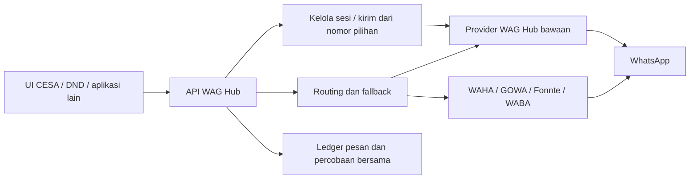

<p align="center">
  
</p>

<h1 align="center">WhatsApp Gateway Hub</h1>

<p align="center">
  Service WhatsApp mandiri dengan UI integrasi, provider bawaan, routing, dan fallback.
</p>

WAG Hub menyediakan provider WhatsApp sendiri melalui runner Baileys dan juga menjadi router untuk WAHA, GOWA, Fonnte, serta WABA. CESA, DND, dan aplikasi lain memakai API yang sama. UI login QR/pairing, status, dan logout dapat ditampilkan di aplikasi klien; socket, kredensial WhatsApp, dan riwayat pengiriman dikelola di WAG Hub.

Aplikasi klien (CESA, DND, Shelf, dan lainnya) cukup memakai dua variabel:

```dotenv
WAG_URL=https://gateway.example.com
WAG_TOKEN=token-khusus-aplikasi
```

Salin keduanya dari panel: **Aplikasi Klien** → **Hubungkan WhatsApp** → langkah
terakhir. Pesan dikirim ke `POST $WAG_URL/api/v2/messages` lewat koneksi default
aplikasi, jadi klien tidak perlu tahu ID koneksi, provider, atau `route_key`.

Lihat [panduan plug and play](docs/PLUG_AND_PLAY_GUIDE.md),
[jaminan kompatibilitas](docs/COMPATIBILITY.md), dan
[migrasi CESA](docs/CESA_WEB.md).

Panduan deploy production dari `git clone`: [docs/DEPLOYMENT_ID.md](docs/DEPLOYMENT_ID.md).
Untuk server 1Panel: [docs/DEPLOYMENT_1PANEL_ID.md](docs/DEPLOYMENT_1PANEL_ID.md).

## Cakupan MVP

- API Bearer token terpisah untuk setiap aplikasi.
- Idempotency key wajib agar request yang diulang tidak terkirim dua kali.
- Mode `sync` untuk OTP/transaksi yang harus menunggu provider menerima pesan.
- Mode `async` untuk notifikasi yang diproses worker.
- Banyak akun WAG Hub bawaan, WAHA, Fonnte, GOWA, dan WABA dengan routing dan fallback berurutan.
- Login QR/pairing, logout, pemulihan sesi, kirim teks, dan cek nomor melalui engine bawaan.
- Engine bawaan saat ini belum mendukung lampiran maupun webhook pesan masuk; gunakan provider eksternal yang mendukungnya untuk fitur tersebut.
- Ledger pesan, attempt provider, latency, event, dan error yang sudah disanitasi.
- Status aman `outcome_unknown` untuk timeout/respons ambigu; Hub tidak melakukan fallback buta.
- Panel Filament untuk aplikasi, credential, provider, route, monitoring, dan retry yang aman.
- Recipient, isi pesan, metadata, serta konfigurasi provider terenkripsi di database; token aplikasi hanya disimpan sebagai hash.



## Menjalankan secara lokal

Gunakan PHP **8.4.1 atau lebih baru** untuk aplikasi, Composer, worker, dan PHP-FPM.
Panduan engine v2 dan deployment terpisah tersedia di [docs/ENGINE_V2.md](docs/ENGINE_V2.md).

```bash
cp .env.example .env
composer install
npm ci
touch database/database.sqlite
php artisan key:generate
php artisan migrate
php artisan storage:link
npm run build
php artisan db:seed
```

`db:seed` membuat administrator default `admin@gateway.local` dengan password
`admin12345`. Nilai tersebut dapat diubah sebelum seed lewat
`GATEWAY_SEED_ADMIN_NAME`, `GATEWAY_SEED_ADMIN_EMAIL`, dan
`GATEWAY_SEED_ADMIN_PASSWORD` di `.env`.
Seeder menyiapkan aplikasi `appscript-ft`, `web-cesa`, `web-shelf`, `web-sam`, dan
`web-helpdesk`. Nama `appscript-ft` digunakan sebagai aplikasi Apps Script yang
tersedia di repository. Jika yang dimaksud adalah aplikasi lain, buat Client
Application baru dari panel.

Tambahkan kredensial provider dan token per aplikasi hanya bila ingin langsung
dipakai saat seed; semua nilai `GATEWAY_SEED_*` bersifat opsional selain tiga
nilai admin. Provider hanya diaktifkan bila konfigurasi lengkap. Tanpa credential, seeder tetap membuat akun
WAHA, Fonnte, GOWA, dan WABA serta route awal dalam status nonaktif agar dapat dilengkapi dari
panel. Seeder dapat dijalankan ulang dengan aman.
Untuk provisioning tanpa menyimpan password di `.env`, gunakan:

```bash
php artisan gateway:create-admin
```

Jalankan aplikasi, worker, dan scheduler pada proses terpisah:

```bash
php artisan serve
php artisan queue:work --tries=1 --timeout=360
php artisan schedule:work
```

`DB_QUEUE_RETRY_AFTER` harus lebih besar daripada timeout worker. Nilai contoh proyek adalah 420 detik.

Pada server pilot/production, kelola web process dan queue worker dengan process manager. Scheduler Laravel wajib dijalankan setiap menit, misalnya melalui cron `php artisan schedule:run`; scheduler ini merekonsiliasi proses stale dan mengantrekan ulang handoff queue yang sempat gagal.

## Endpoint provider

URL provider diambil dari akun provider. Tidak perlu mendaftarkan hostname di environment.

```dotenv
GATEWAY_PROVIDER_FAILURE_THRESHOLD=3
GATEWAY_PROVIDER_CIRCUIT_SECONDS=300
```

- HTTP dan HTTPS ke hostname publik diterima.
- `localhost`, literal private/loopback IP, metadata host, userinfo URL, dan redirect tidak diikuti.
- Setelah mengubah konfigurasi: jalankan `php artisan config:cache`, lalu `php artisan queue:restart` agar worker memakai konfigurasi terbaru.

## Konfigurasi awal

1. Masuk ke `/panel` memakai administrator yang dibuat lewat command.
2. Buat **Aplikasi Klien**.
3. Buka **Hubungkan WhatsApp**: pakai nomor sendiri (QR/pairing) atau provider.
4. Kirim pesan uji.
5. Salin `WAG_URL` dan `WAG_TOKEN` ke `.env` aplikasi klien.

Akun provider, aturan rute, dan fallback adalah pengaturan lanjutan dan tidak
perlu diketahui aplikasi klien.

## Seeder manajemen awal

`php artisan db:seed` membuat data administrasi yang konsisten untuk seluruh
aplikasi sumber. Provider aktif diurutkan WAHA, Fonnte, GOWA, lalu WABA pada
default route setiap aplikasi. Urutan dapat diubah dari panel. Route Shelf
bernama `shelf-notifications`; karena ia ditandai default, konfigurasi Shelf yang
masih memakai `WHATSAPP_HUB_ROUTE_KEY=default` tetap dapat menggunakan route ini.

Setiap `GATEWAY_SEED_*_TOKEN` membuat credential bernama `Seeded application
token` untuk aplikasi yang sesuai, dengan ability `messages:send` dan
`messages:read`. Token hanya disimpan sebagai hash; putar token bila pernah
tersimpan atau terekspos di file `.env`.

Untuk pilot Shelf, gunakan aplikasi `web-shelf`, purpose `notification`, dan satu route key yang sama persis pada Hub dan konfigurasi Shelf. Panel menolak scope route yang sama dibuat dua kali.

Jangan menyalin credential lama dari source code. Credential provider yang pernah tertanam di aplikasi lama harus dirotasi sebelum pilot.

### Catatan GOWA dan WABA

- GOWA memakai `POST /send/message`, Basic Auth, dan `X-Device-Id` opsional untuk server multi-device.
- WABA memakai Meta Cloud API resmi dengan Phone Number ID dan System User Access Token.
- Lookup registrasi nomor tersedia untuk WAG Hub bawaan, WAHA, Fonnte, dan GOWA. Meta WABA tidak menyediakan lookup penerima tanpa mengirim pesan, sehingga hasil WABA adalah `unsupported`.
- Driver WABA saat ini mengirim pesan teks bebas. Meta hanya mengizinkannya dalam customer-service window yang berlaku; pesan di luar window harus memakai template, yang belum menjadi bagian kontrak message Hub saat ini.
- `GATEWAY_SEED_WABA_API_VERSION` dapat dinaikkan tanpa perubahan kode ketika versi Graph API berubah.

## Mengirim pesan

```bash
curl -X POST "$WAG_URL/api/v2/messages" \
  -H "Authorization: Bearer $WAG_TOKEN" \
  -H 'Idempotency-Key: order-1001' \
  -H 'Content-Type: application/json' \
  -d '{"to": "081234567890", "text": "Pesanan Anda sudah dikirim."}'
```

- `to` boleh nomor lokal atau berformat (`0812-3456-7890`, `+62 812 …`).
  Nomor `0…` otomatis diberi kode negara `GATEWAY_DEFAULT_COUNTRY_CODE` (default `62`).
- `Idempotency-Key` wajib. Request ulang dengan key yang sama tidak pernah terkirim dua kali.
- Respons selalu `202` dengan `data.id` dan `data.status`.
- `connection` (opsional) hanya perlu bila aplikasi punya beberapa nomor tanpa
  default. Koneksi pertama otomatis menjadi default.

Kirim file lewat URL publik; `text` menjadi caption:

```bash
curl -X POST "$WAG_URL/api/v2/messages" \
  -H "Authorization: Bearer $WAG_TOKEN" \
  -H 'Idempotency-Key: invoice-1001' \
  -H 'Content-Type: application/json' \
  -d '{"to": "081234567890", "document": "https://cdn.example.com/INV-1001.pdf", "text": "Invoice Anda"}'
```

Kunci file: `image`, `document`, atau `voice` (khusus nomor terkelola). Batas 16 MB.

Cek status pesan:

```bash
curl "$WAG_URL/api/v2/messages/ID_PESAN" \
  -H "Authorization: Bearer $WAG_TOKEN"
```

| Status | Makna |
|---|---|
| `queued` | Menunggu dikirim. |
| `sent` | Terkirim. |
| `delivered` | Sampai di perangkat penerima. |
| `read` | Dibaca. |
| `failed` | Gagal. |
| `expired` | Batas waktu lewat sebelum terkirim. |
| `unknown` | Hasil tidak pasti; ulangi dengan `Idempotency-Key` yang sama. |

Contoh klien: [PHP](docs/examples/php/WagClient.php),
[JavaScript](docs/examples/javascript/wag.js),
[Python](docs/examples/python/wag.py).

## Mengecek nomor WhatsApp

`WAG_TOKEN` dari panel sudah memiliki ability `numbers:check`. Pengecekan memakai
**Aturan Rute** berjenis **Cek nomor WhatsApp** (terpisah dari rute kirim pesan);
provider diperiksa berurutan dan berhenti ketika hasilnya sudah definitif.

```bash
curl -X POST "$WAG_URL/api/v1/number-checks" \
  -H "Authorization: Bearer $WAG_TOKEN" \
  -H 'Content-Type: application/json' \
  -d '{"recipient": {"type": "phone", "value": "081234567890"}}'
```

Hasil agregat:

| Status | Makna |
|---|---|
| `registered` | Sedikitnya satu provider memastikan nomor terdaftar, tanpa hasil negatif. |
| `not_registered` | Sedikitnya satu provider memastikan nomor tidak terdaftar, tanpa hasil positif. |
| `unknown` | Provider gagal, tidak tersedia, atau responsnya tidak dapat dipastikan. Bukan berarti nomor invalid. |
| `unsupported` | Seluruh provider pada rute tidak mendukung lookup tanpa efek samping. |

Respons juga berisi `checks` sesuai urutan percobaan provider. Client tidak dapat
memilih provider atau credential secara langsung. Pengecekan memiliki bucket
rate-limit sendiri sehingga tidak mengurangi kuota pengiriman pesan.

Setiap request valid memiliki `data.id` sebagai ID audit. Bila route/provider tidak
tersedia, ID yang sama dikembalikan melalui `error.audit_id`. Riwayat dapat dilihat
di **WhatsApp → Pengecekan Nomor** (`/panel/number-checks`) dan mencatat:

- aplikasi serta credential peminta;
- ID korelasi, route, waktu mulai dan selesai;
- nomor terenkripsi, hash pencarian, dan empat digit terakhir untuk tampilan;
- hasil akhir serta provider yang memberi hasil definitif;
- urutan attempt, status, kode alasan, HTTP status, dan latency setiap provider.

Audit pengecekan disimpan pada ledger tersendiri dan tidak membuat
`gateway_messages`, `message_attempts`, atau `message_events`.

## API legacy v1

`POST /api/v1/messages` (dengan `route_key`, `purpose`, `mode`), `POST /api/v1/attachments`,
`GET /api/v1/messages/{uuid}`, dan `/api/v1/engine` tetap berjalan untuk klien lama.
Kontraknya tidak berubah; lihat [COMPATIBILITY.md](docs/COMPATIBILITY.md).
Integrasi baru memakai `POST /api/v2/messages`.

Status ledger v1: `queued`, `processing`, `provider_accepted`, `failed`,
`outcome_unknown`, dan `expired`. Kegagalan definitif dapat berpindah ke provider
berikutnya. Timeout, HTTP 5xx, atau respons ambigu menjadi `outcome_unknown` dan
tidak memicu fallback untuk pesan tersebut.

Pemetaan lampiran per provider:

| Jenis | WAHA | Fonnte | GOWA | WABA |
|---|---|---|---|---|
| `image` | `POST /api/sendImage` | `/send` + `url` | `POST /send/image` (`image_url`) | `type: image` + `link` |
| `document` | `POST /api/sendFile` | `/send` + `url`, `filename` | `POST /send/file` (`file_url`) | `type: document` + `link`, `filename` |
| `video` | `POST /api/sendVideo` | `/send` + `url` | `POST /send/video` (`video_url`) | `type: video` + `link` |
| `audio` | `POST /api/sendVoice` | `/send` + `url` | `POST /send/audio` (`audio_url`) | `type: audio` + `link` |

Batas provider tetap berlaku: Fonnte 4 MB (dapat diatur per akun), WABA image 5 MB,
WABA audio/video 16 MB, WABA document 100 MB. WAHA audio harus OGG/Opus. URL
dokumen GOWA membutuhkan GOWA v8.10.0 atau lebih baru.

## Mengaktifkan pilot web-shelf

Isi environment pada host Shelf, lalu recache konfigurasi:

```dotenv
WAG_URL=https://gateway.example.com
WAG_TOKEN=token-khusus-web-shelf
```

```bash
php artisan config:cache
```

Shelf tidak membutuhkan credential provider. Reminder terjadwal menurunkan
`Idempotency-Key` dari identitas business event, sehingga timeout dan retry
memakai pesan Hub yang sama.

## Checklist pilot

- Hub memakai `APP_ENV=production`, `APP_DEBUG=false`, `APP_URL` HTTPS, `APP_KEY` persisten dan dibackup.
- Database production, backup, web process, queue worker, dan scheduler aktif.
- Worker telah direstart setelah perubahan konfigurasi.
- Credential lama yang pernah tertanam di aplikasi/Apps Script sudah dirotasi.
- Satu smoke test nyata untuk setiap provider aktif diverifikasi dari ledger sebelum trafik aplikasi dialihkan.
- Adapter Shelf memakai `WAG_URL`/`WAG_TOKEN` dan `POST /api/v2/messages`, sudah masuk branch deployment (`staging`/`main`), dan environment Shelf telah direcache.

Cleanup attachment otomatis berjalan melalui scheduler: upload yang tidak pernah dipakai dihapus setelah 24 jam dan file terpakai setelah 90 hari sejak referensi terakhir. Webhook inbound/delivered/read belum termasuk MVP; jaga endpoint inbound aplikasi lama tetap di jaringan tepercaya sampai fase autentikasi inbound dikerjakan.

## Verifikasi

```bash
php artisan test
vendor/bin/pint --test
composer audit
npm audit
npm run build
```

Coverage 80% dijalankan di CI/runtime yang menyediakan Xdebug atau PCOV.

Kontrak, model data, use case, dan traceability MVP tersedia di [`docs/chain-of-truth`](docs/chain-of-truth/).
